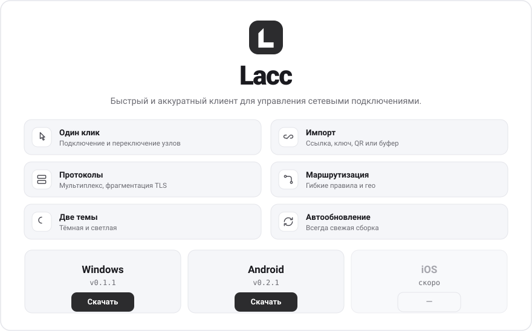

<picture>
  <source media="(prefers-color-scheme: dark)" srcset="assets/cover-dark.svg">
  
</picture>

  <b>Скачать:</b>
  <a href="../../releases/latest">Windows — установщик · MSI</a>
  &nbsp;·&nbsp;
  <a href="https://check.lacc.ru/updates/android/lacc-0.2.1.apk">Android — APK (~124 МБ)</a>
  &nbsp;·&nbsp;
  iOS — скоро

  После установки приложение само загрузит необходимый компонент и обновляется автоматически.
  &nbsp;·&nbsp; Сайт — <a href="https://lacc.ru">lacc.ru</a>
  &nbsp;·&nbsp; Обратная связь — <a href="../../issues">Issues</a>

> Lacc — сетевая утилита. Приложение не предоставляет серверов и доступа к ресурсам:
> конфигурацию и узлы предоставляет ваш сервис-провайдер. Здесь публикуются только
> готовые сборки; исходный код проекта приватный.
