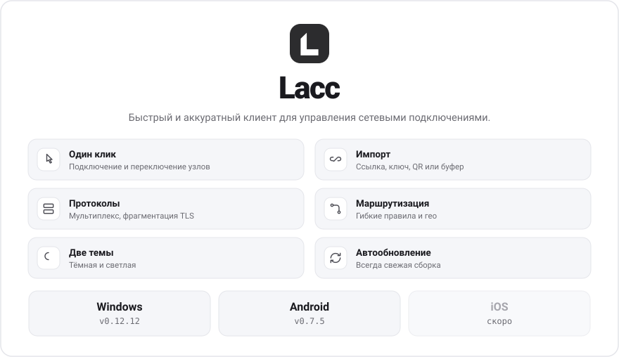

<picture>
  <source media="(prefers-color-scheme: dark)" srcset="assets/banner-dark-20261031-w01212-a075.svg">
  
</picture>

  <a href="../../releases/latest"><picture><source media="(prefers-color-scheme: dark)" srcset="assets/dl-windows-dark.svg"></picture></a>
  &nbsp;
  <a href="https://check.lacc.ru/download/android"><picture><source media="(prefers-color-scheme: dark)" srcset="assets/dl-android-dark.svg"></picture></a>

iOS — скоро &nbsp;·&nbsp; <a href="https://lacc.ru">lacc.ru</a> &nbsp;·&nbsp; <a href="../../issues">Обратная связь</a>

_Lacc — сетевая утилита. Приложение не предоставляет серверов и доступа к ресурсам: конфигурацию и узлы предоставляет ваш сервис-провайдер._
